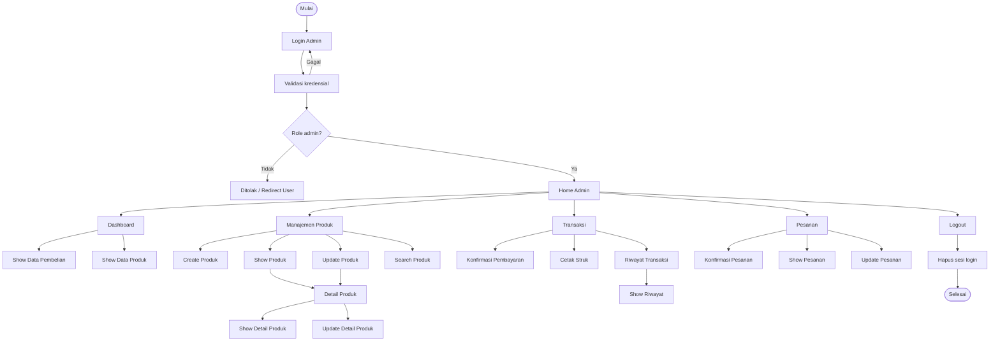
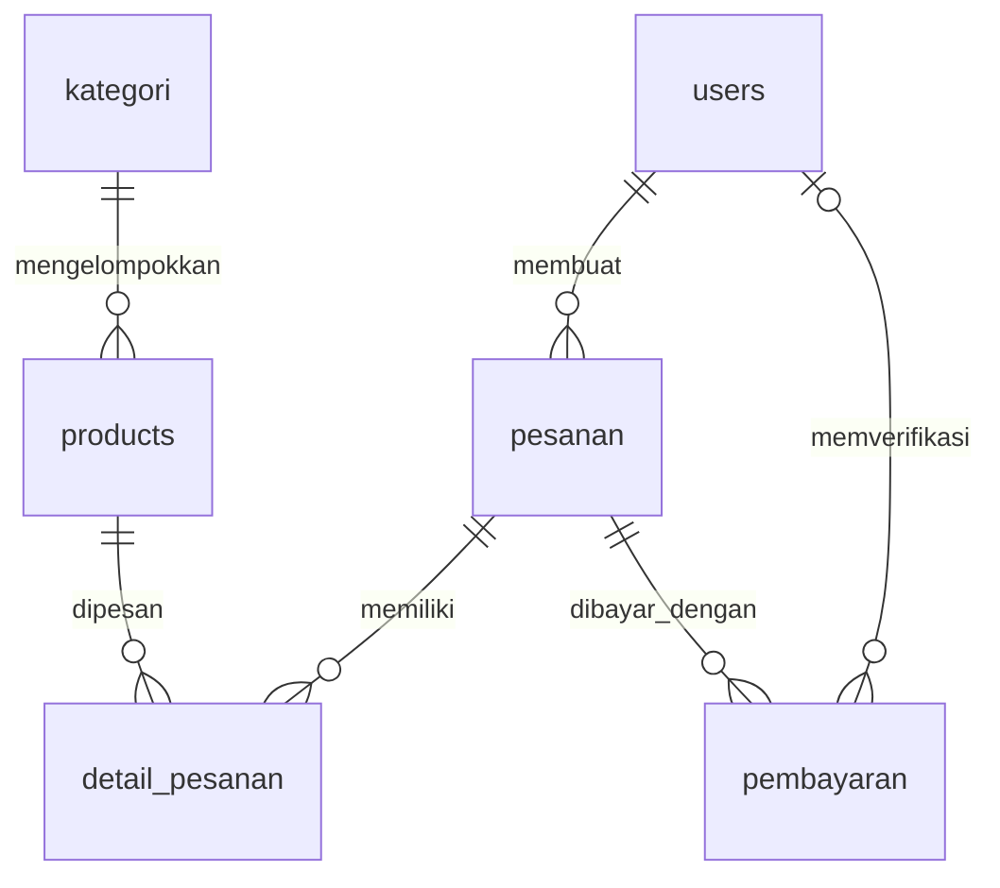

# Dokumentasi Alur Admin — E-Commerce Bunga

## 1. Tujuan Dokumen

Dokumen ini menjelaskan alur penggunaan aplikasi E-Commerce Bunga dari sisi **Admin** berdasarkan sitemap Admin dan schema database. Dokumen menjadi acuan implementasi halaman Admin, routing, controller, middleware, dan proses operasional.

## 2. Hak Akses Admin

Admin dapat:
- Melihat dashboard dan ringkasan data pembelian serta produk.
- Membuat, melihat, mencari, dan memperbarui produk.
- Melihat serta memperbarui detail produk.
- Mengonfirmasi pembayaran.
- Mencetak struk.
- Melihat riwayat transaksi.
- Memperbarui progres pesanan setelah pembayaran disetujui; Admin tidak dapat membatalkan atau menyelesaikan pesanan.
- Logout.

Admin harus login dan memiliki `users.role = admin`. User biasa tidak boleh mengakses fitur Admin.

## 3. Alur Utama Admin

## 4. Detail Alur per Fitur

### 4.1 Login Admin
1. Admin membuka halaman Login.
2. Admin memasukkan username/email dan password.
3. Backend memvalidasi kredensial.
4. Backend memeriksa `users.role`.
5. Jika role `admin`, Admin diarahkan ke Home Admin.
6. Jika role bukan `admin`, akses Admin ditolak.

**Tabel:** `users`  
**Kolom:** `id_user`, `username`, `email`, `password`, `role`.

### 4.2 Dashboard
Dashboard menampilkan ringkasan data operasional, misalnya:
- Jumlah produk.
- Jumlah pesanan.
- Jumlah transaksi/pembayaran.
- Ringkasan pembelian atau pendapatan sesuai status yang dipilih.

**Tabel:** `products`, `pesanan`, `detail_pesanan`, `pembayaran`.

> Nilai dashboard harus dihitung dari database. Definisi pendapatan perlu menetapkan status pembayaran/pesanan yang dianggap berhasil.

### 4.3 Manajemen Produk

#### Create Produk
1. Admin membuka form tambah produk.
2. Admin mengisi nama, kategori, deskripsi, harga, stok, dan gambar.
3. Backend memvalidasi data dan kategori.
4. Backend membuat `id_produk` UUID.
5. Produk disimpan ke tabel `products`.

#### Show Produk
1. Admin membuka daftar produk.
2. Sistem menampilkan produk dan kategori.
3. Admin dapat membuka detail produk.

#### Search Produk
1. Admin memasukkan kata kunci.
2. Backend mencari produk berdasarkan nama atau atribut yang ditentukan.
3. Hasil ditampilkan dengan pagination jika diperlukan.

#### Update Produk
1. Admin memilih produk.
2. Admin mengubah data produk.
3. Backend memvalidasi perubahan.
4. Data `products` diperbarui.

**Tabel:** `products`, `kategori`.  
**Relasi:** `products.id_kategori` → `kategori.id_kategori`.

### 4.4 Detail Produk
- **Show Detail Produk:** menampilkan informasi lengkap produk, kategori, harga, stok, deskripsi, dan gambar.
- **Update Detail Produk:** Admin mengubah informasi produk melalui form edit, lalu backend menyimpan perubahan.

**Tabel:** `products`, `kategori`.

### 4.5 Transaksi

#### Konfirmasi Pembayaran
1. Admin membuka daftar pembayaran yang menunggu verifikasi.
2. Admin memeriksa detail pesanan dan bukti pembayaran.
3. Admin menerima atau menolak bukti pembayaran.
4. Backend mengubah `pembayaran.bukti_pembayaran` menjadi `accept` atau `decline`.
5. Backend memperbarui `status_pembayaran` sesuai hasil verifikasi.
6. Backend menyimpan `id_admin_verifikator` dan `verified_at`.
7. Jika pembayaran diterima, `paid_at` diisi dan pesanan tetap `pending` sampai Admin memprosesnya.
8. Jika pembayaran ditolak, status pembayaran menjadi `failed`, status pesanan menjadi `rejected`, dan stok yang dicadangkan dikembalikan.

**Tabel:** `pembayaran`, `pesanan`, `detail_pesanan`, `users`.

#### Cetak Struk
1. Admin membuka transaksi/pesanan yang sudah terverifikasi.
2. Sistem mengambil data pesanan, detail produk, total, dan pembayaran.
3. Sistem menghasilkan halaman atau PDF struk.

**Tabel:** `pesanan`, `detail_pesanan`, `products`, `pembayaran`, `users`.

### 4.6 Riwayat Transaksi
1. Admin membuka Riwayat Transaksi.
2. Sistem menampilkan transaksi/pembayaran yang telah tercatat.
3. Admin dapat membuka detail riwayat.

**Tabel:** `pesanan`, `detail_pesanan`, `pembayaran`, `users`.

### 4.7 Pesanan

#### Show Pesanan
1. Admin membuka daftar pesanan.
2. Sistem menampilkan nomor pesanan, user, tanggal, total, dan status.
3. Admin membuka detail pesanan untuk melihat item.

#### Update Pesanan
1. Admin membuka detail pesanan.
2. Status hanya dapat diproses setelah user mengunggah bukti pembayaran dan Admin menyetujuinya.
3. Admin hanya dapat mengubah status `pending` → `processing` → `shipped`.
4. Admin tidak dapat membatalkan pesanan atau menandainya selesai.
5. Setelah barang diterima, user mengonfirmasi penerimaan dan status menjadi `completed`.

Status pesanan:
- `pending`
- `processing`
- `shipped`
- `completed`
- `rejected` (pembayaran ditolak oleh Admin)
- `cancelled` (dibatalkan pembeli sebelum bukti pembayaran diunggah)
- `cancelled` (khusus pembatalan oleh user sebelum bukti pembayaran diunggah)

**Tabel:** `pesanan`, `detail_pesanan`, `products`, `users`, `pembayaran`.

### 4.8 Logout
1. Admin memilih Logout.
2. Backend menghapus/invalidate sesi atau token.
3. Admin diarahkan ke Login.

## 5. Ringkasan Pemetaan Fitur dan Database

| Fitur Admin | Tabel utama | Keterangan |
|---|---|---|
| Login | `users` | Validasi role admin |
| Dashboard | `products`, `pesanan`, `pembayaran` | Ringkasan operasional |
| Create Produk | `products`, `kategori` | Menambahkan produk |
| Show/Search Produk | `products`, `kategori` | Daftar dan pencarian |
| Update/Detail Produk | `products`, `kategori` | Informasi produk |
| Konfirmasi Pembayaran | `pembayaran`, `pesanan`, `users` | Verifikasi oleh Admin |
| Cetak Struk | `pesanan`, `detail_pesanan`, `pembayaran`, `products` | Data struk |
| Riwayat Transaksi | `pembayaran`, `pesanan` | Riwayat pembayaran/pesanan |
| Show Pesanan | `pesanan`, `detail_pesanan`, `users` | Daftar dan detail pesanan |
| Update Pesanan | `pesanan`, `pembayaran` | `pending` → `processing` → `shipped`; selesai dikonfirmasi user |
| Logout | Session/token | Mengakhiri sesi |

## 6. Relasi Database

## 7. Catatan Implementasi

- Lindungi seluruh route Admin dengan middleware autentikasi dan role `admin`.
- Jangan hanya menyembunyikan menu Admin di frontend; validasi role wajib dilakukan backend.
- Gunakan UUID 36 karakter untuk ID baru.
- Validasi kategori, harga, stok, dan file gambar saat produk dibuat/diperbarui.
- Gunakan transaksi database untuk proses verifikasi pembayaran dan perubahan status yang saling terkait.
- Catat `id_admin_verifikator` dan `verified_at` saat verifikasi pembayaran.
- Terapkan aturan transisi status pesanan agar status tidak berubah sembarangan.
- Schema belum memiliki tabel khusus log aktivitas Admin atau pengiriman. Jika dibutuhkan, tambahkan tabel/kolom sesuai kebutuhan.
