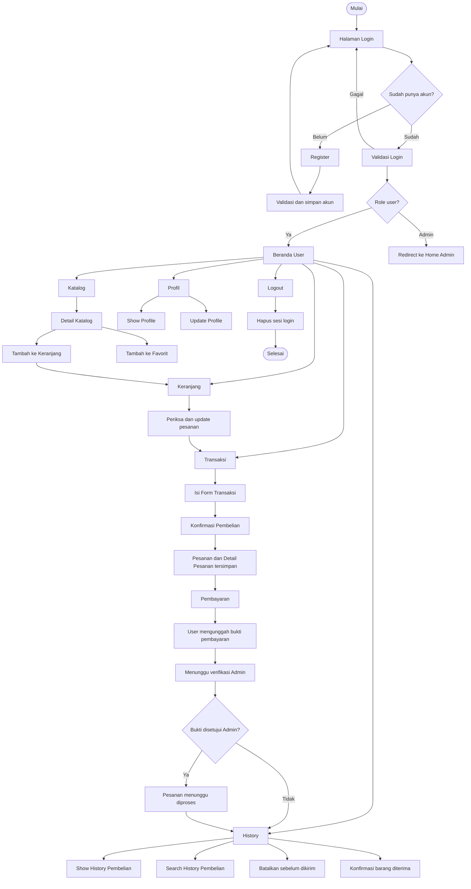
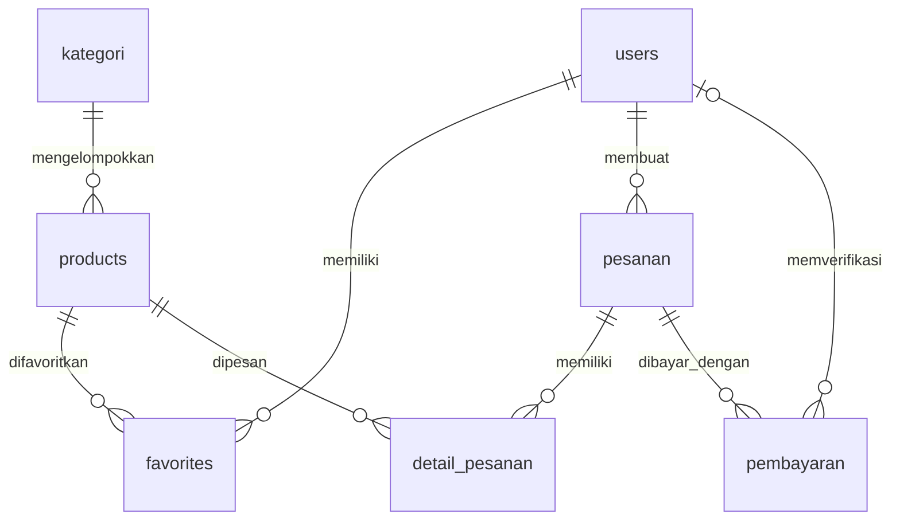

# Dokumentasi Alur User — E-Commerce Bunga

## 1. Tujuan Dokumen

Dokumen ini menjelaskan alur penggunaan aplikasi E-Commerce Bunga dari sisi **User** berdasarkan sitemap user dan schema database. Dokumen dapat digunakan sebagai acuan implementasi frontend, backend Laravel, routing, controller, dan validasi.

## 2. Hak Akses User

User yang sudah login dapat:
- Melihat katalog dan detail produk.
- Menambahkan produk ke keranjang dan favorit.
- Mengelola pesanan/keranjang.
- Melakukan transaksi dan mengonfirmasi pembelian.
- Melihat serta mencari riwayat pembelian.
- Membatalkan pesanan sebelum bukti pembayaran diunggah dan mengonfirmasi penerimaan barang.
- Melihat dan memperbarui profil.
- Logout.

User tidak boleh mengakses halaman atau aksi khusus Admin.

## 3. Alur Utama User

## 4. Detail Alur per Fitur

### 4.1 Login dan Register
1. User membuka halaman Login.
2. User memasukkan username/email dan password.
3. Backend memvalidasi kredensial.
4. Backend membaca `users.role`.
5. Jika role `user`, arahkan ke halaman User.
6. Jika role `admin`, arahkan ke halaman Admin.
7. Jika belum memiliki akun, user membuka Register.
8. Form register divalidasi; username dan email harus unik.
9. Password disimpan dalam bentuk hash, bukan teks biasa.

**Tabel:** `users`  
**Kolom penting:** `id_user`, `nama`, `username`, `email`, `password`, `no_hp`, `alamat`, `role`, `profil_user`.

### 4.2 Katalog dan Detail Katalog
1. User membuka Katalog.
2. Sistem menampilkan produk aktif/tersedia beserta kategori, harga, stok, dan gambar.
3. User dapat mencari produk.
4. User memilih produk untuk membuka Detail Katalog.
5. Detail menampilkan deskripsi, harga, stok, gambar, dan informasi kategori.
6. User dapat menambahkan produk ke keranjang atau favorit.

**Tabel:** `products`, `kategori`, `favorites`  
**Relasi:** `products.id_kategori` → `kategori.id_kategori`.

> Schema saat ini belum memiliki kolom status produk. Jika katalog perlu menyembunyikan produk nonaktif, tambahkan kolom status pada tabel `products` atau tentukan aturan berdasarkan stok.

### 4.3 Keranjang
1. User membuka Keranjang.
2. Sistem menampilkan item yang dipilih, jumlah, harga satuan, dan subtotal.
3. User dapat mengubah jumlah atau menghapus item.
4. Sistem menghitung ulang subtotal dan total.
5. User melanjutkan ke transaksi.

**Pemetaan database:** Schema yang diberikan belum memiliki tabel `cart` dan `cart_items`. Keranjang dapat dibuat sebagai state/session sementara atau ditambahkan tabel khusus. Jika item keranjang langsung disimpan sebagai pesanan, status dan mekanisme checkout harus dirancang secara konsisten.

### 4.4 Transaksi dan Konfirmasi Pembelian
1. User memilih checkout dari keranjang.
2. User mengisi form transaksi, misalnya alamat pengiriman dan catatan jika diperlukan.
3. Backend memvalidasi stok dan jumlah item.
4. Backend menghitung total dari harga produk di database (jangan mempercayai total dari frontend).
5. Backend membuat data `pesanan`.
6. Backend membuat setiap item pada `detail_pesanan`.
7. Stok produk dikurangi pada waktu yang ditentukan oleh aturan bisnis.
8. User memilih metode pembayaran: `dana`, `gopay`, atau `bank`.
9. Data pembayaran dibuat di `pembayaran` dengan status awal `pending`.
10. User mengunggah bukti pembayaran.
11. Admin memeriksa dan menyetujui bukti pembayaran sebelum status pesanan dapat diproses.

**Tabel:** `pesanan`, `detail_pesanan`, `pembayaran`, `products`, `users`.

### 4.5 History Pembelian
1. User membuka History.
2. Sistem menampilkan pesanan milik user yang sedang login.
3. User dapat mencari riwayat berdasarkan nomor pesanan atau informasi yang relevan.
4. User membuka detail pesanan untuk melihat item, total, status pesanan, dan status pembayaran.
5. User dapat membatalkan pesanan hanya saat statusnya `pending` dan sebelum mengunggah bukti pembayaran.
6. Setelah bukti pembayaran diunggah, user tidak dapat membatalkan pesanan.
7. Setelah pesanan berstatus `shipped` dan barang diterima, user menekan tombol konfirmasi penerimaan agar status menjadi `completed`.

Status pesanan: `pending` (default), `processing`, `shipped`, `completed`, `cancelled` (dibatalkan sebelum bukti pembayaran diunggah), dan `rejected` (pembayaran ditolak Admin). Status `completed` hanya dapat diubah oleh konfirmasi penerimaan dari user setelah pesanan dikirim.

**Tabel:** `pesanan`, `detail_pesanan`, `pembayaran`, `products`.  
**Aturan keamanan:** query riwayat harus dibatasi dengan `pesanan.id_user` milik user yang login.

### 4.6 Favorit
1. User menekan tombol tambah favorit pada produk.
2. Backend menyimpan `id_user` dan `id_produk` pada `favorites`.
3. Kombinasi user dan produk tidak boleh duplikat.
4. User dapat melihat atau menghapus produk dari daftar favorit.

**Tabel:** `favorites`, `users`, `products`.

### 4.7 Profil
- **Show Profile:** menampilkan nama, username, email, nomor HP, alamat, dan foto profil.
- **Update Profile:** user memperbarui data miliknya sendiri; email/username tetap harus unik.
- Password hanya diperbarui melalui form khusus dan harus di-hash.

**Tabel:** `users`.

### 4.8 Logout
1. User memilih Logout.
2. Backend menghapus/invalidate sesi atau token autentikasi.
3. User diarahkan ke Login.

## 5. Ringkasan Pemetaan Fitur dan Database

| Fitur | Tabel utama | Keterangan |
|---|---|---|
| Login/Register | `users` | Autentikasi dan role |
| Katalog | `products`, `kategori` | Daftar produk |
| Detail katalog | `products`, `kategori` | Detail produk |
| Favorit | `favorites` | Relasi user-produk |
| Keranjang | Belum tersedia | Tambahkan tabel atau gunakan session |
| Checkout | `pesanan`, `detail_pesanan` | Header dan item pesanan |
| Pembayaran | `pembayaran` | Metode, status, bukti/verifikasi |
| History | `pesanan`, `detail_pesanan`, `pembayaran` | Riwayat milik user |
| Profil | `users` | Data akun |
| Logout | Session/token | Tidak membutuhkan tabel bisnis baru |

## 6. Relasi Database

## 7. Catatan Implementasi

- Gunakan UUID string 36 karakter untuk seluruh ID sesuai schema.
- Gunakan transaksi database (`DB::transaction`) saat checkout agar pembuatan pesanan, detail, dan pembayaran konsisten.
- Validasi stok di backend dan cegah stok menjadi negatif.
- Harga dan subtotal dihitung backend.
- Batasi akses data berdasarkan user yang sedang login.
- Gunakan middleware autentikasi dan role.
- Schema belum menyediakan tabel alamat pengiriman, cart, atau cancel request terpisah. Fitur tersebut perlu memakai aturan/status yang ada atau penambahan tabel/kolom jika dibutuhkan.
